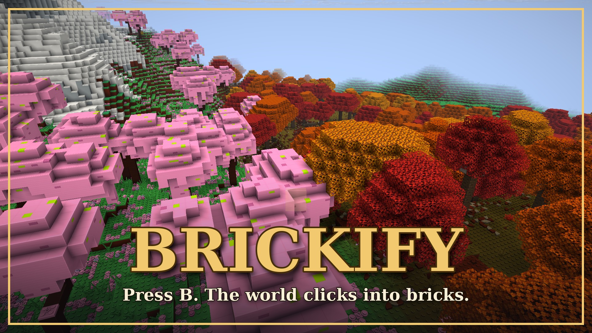

# Brickify

Press **B** and the world around you turns into toy bricks. Hit mobs and they fall apart into pieces, blow up a house with TNT and it bursts into bricks, then press **R** to snap everything back together.

A Minecraft **26.3** mod for **Fabric**.

## Download

Grab `brickify-0.1.0.jar` from the [latest release](https://github.com/moritzfh/brickify/releases/latest) and drop it into your `mods` folder.

You also need:
- [Fabric Loader](https://fabricmc.net/use/installer/)
- [Fabric API](https://modrinth.com/mod/fabric-api)

> **Singleplayer only for now.** Multiplayer is not supported yet.

## Controls

| Key | What it does |
| --- | --- |
| **B** | Turn brick mode on or off |
| **R** | Rebuild the nearest broken thing |
| **Hold R** | Rebuild everything around you |

Both keys can be changed under Options → Controls.

## Video

More on YouTube: [@RustyHS](https://www.youtube.com/@RustyHS)

## Credits

The brick block models and textures are based on [Plasticraft](https://modrinth.com/resourcepack/plasticraft) by Inferno31415 (CC0-1.0).

## Disclaimer

Brickify is a fan project and is not affiliated with, endorsed by or connected to the LEGO Group or Mojang. LEGO® is a trademark of the LEGO Group.

All rights reserved.
