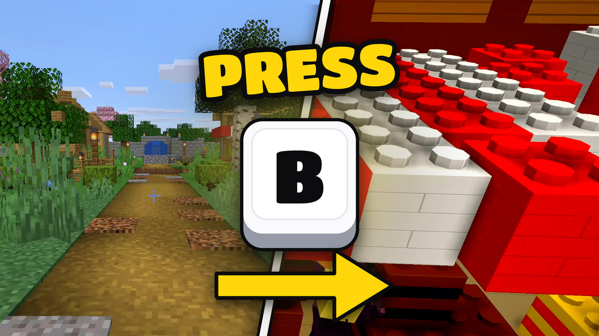
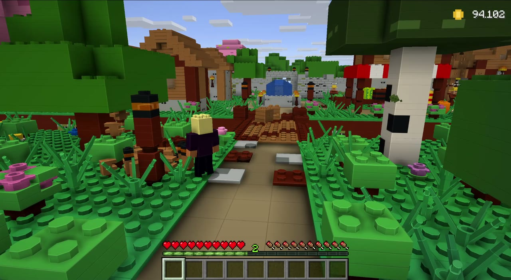
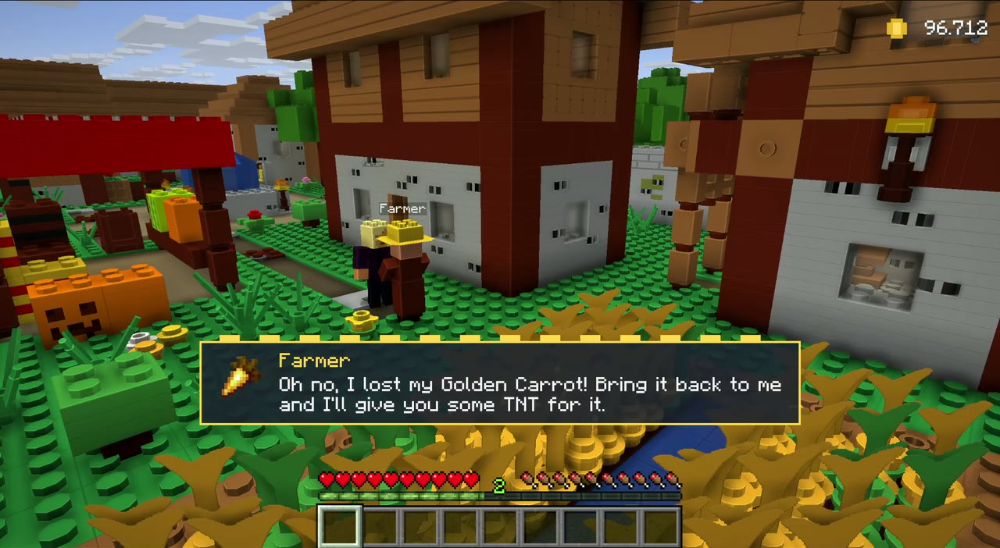
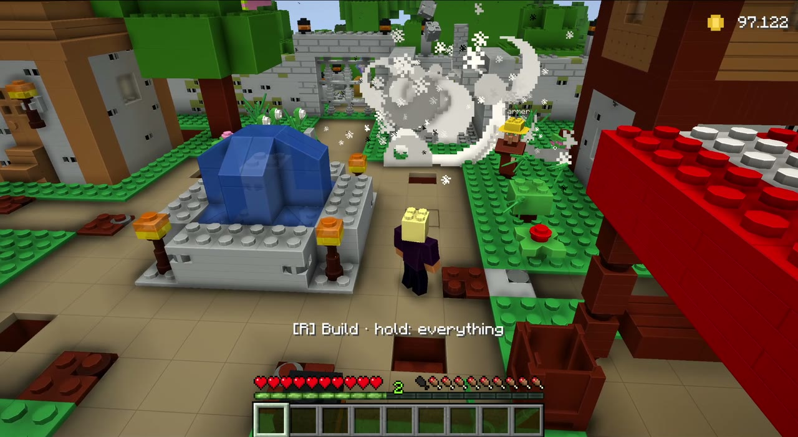
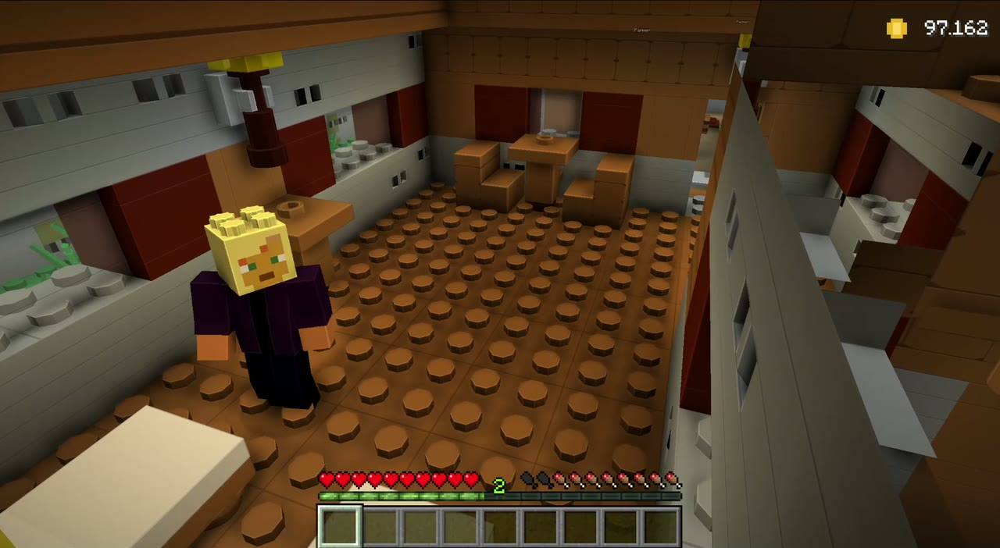
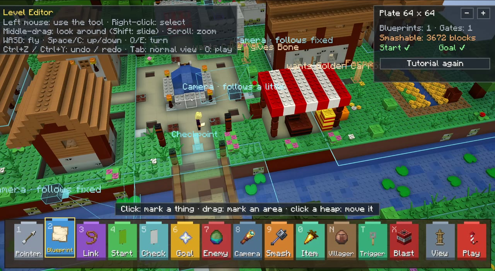
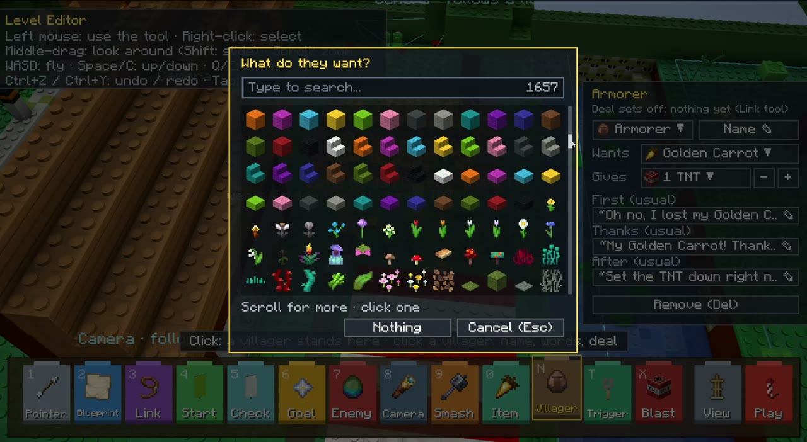

# Brickify

Press **B** and the world around you turns into toy bricks. Then it plays like a LEGO game: fixed cameras, villager quests, bridges you rebuild brick by brick, walls only TNT can break. And with the **level editor** you build your own brick levels, right inside Minecraft.

A Minecraft **26.3** mod for **Fabric**.

## Video

▶️ **[Watch the big update on YouTube](https://youtu.be/OTvTccfxH2I)** · [First look (Short)](https://youtube.com/shorts/9QYvJqz6cDo)

## Download

Grab the newest `.jar` from the **[latest release](https://github.com/moritzfh/brickify/releases/latest)** and drop it into your `mods` folder.

You also need:
- [Fabric Loader](https://fabricmc.net/use/installer/)
- [Fabric API](https://modrinth.com/mod/fabric-api)

Optional:
- [Smooth Player Animations](https://modrinth.com/mod/smoothplayeranimations) for nicer player movement
- [Carry On](https://modrinth.com/mod/carry-on) to carry TNT and blocks in your arms

> **Singleplayer only for now.** Multiplayer is not supported yet.

## What's in it

<table>
<tr>
<td width="50%"> <b>Play like a LEGO game.</b> Fixed cameras, bridges you rebuild with R, checkpoints and a goal.</td>
<td width="50%"> <b>Villager quests.</b> Villagers want something and give you something back, like a box of TNT.</td>
</tr>
<tr>
<td> <b>Walls only TNT can break.</b> Carry TNT over, set it down, run. Everything bursts into bricks.</td>
<td> <b>Go inside.</b> Every room can have its own camera, and walls in the way turn see-through.</td>
</tr>
<tr>
<td> <b>Level editor.</b> Build your level from above in the diorama view or in the normal view. A tutorial walks you through it.</td>
<td> <b>Make it your own.</b> Villagers with names and lines, items to find, enemies, triggers, explosions, camera zones.</td>
</tr>
</table>

## Controls

| Key | What it does |
| --- | --- |
| **B** | Turn brick mode on or off |
| **R** | Rebuild the nearest broken thing |
| **Hold R** | Rebuild everything around you |
| **O** | Level editor: switch between building and playing |
| **Tab** | Editor: diorama view / normal view |
| **V** | Fixed camera on or off |
| **K** | Physics: normal / strict / off |
| **Right-click / F** | Talk to a villager |

Keys can be changed under Options → Controls.

## Community

- 💬 Discord: [discord.gg/k2MB8SrYdm](https://discord.gg/k2MB8SrYdm)
- ▶️ YouTube: [@RustyHS](https://www.youtube.com/@RustyHS)
- ☕ Support my mods: [ko-fi.com/rustyhs](https://ko-fi.com/rustyhs)

## Source code

The full source is in this repository, so you can see how Brickify works.

To build it yourself you need Java 25: run `gradlew build`, and the jar ends up in `build/libs`.

The source is public, but Brickify is **not** open source: please don't reupload the mod or release changed versions of it. Read the [license](LICENSE) for what you can and can't do. Ideas and fixes are welcome as issues or pull requests.

## Credits

The brick block models and textures are based on [Plasticraft](https://modrinth.com/resourcepack/plasticraft) by Inferno31415 (CC0-1.0).

## License

Source available, all rights reserved. See [LICENSE](LICENSE).

Brickify is a fan project and is not affiliated with, endorsed by or connected to the LEGO Group or Mojang. LEGO® is a trademark of the LEGO Group.
